# 利用 CRISP-DM 架構的線性回歸分析：洪水機率預測 (Kaggle Playground S4E5)

> 物聯網應用與資料分析 HW2 — 以 Streamlit 建立的互動式線性回歸分析網頁，完整走過 CRISP-DM 六個階段。

| 項目 | 內容 |
|---|---|
| 資料集 | Kaggle Playground Series S4E5 — *Regression with a Flood Prediction Dataset* |
| 資料連結 | <https://www.kaggle.com/competitions/playground-series-s4e5/data> |
| 程式碼 | <https://github.com/marukomaru777/crisp-dm-linear-regression> |
| 特徵數 | 20 個風險因子 (符合 10 ~ 20 個特徵的要求) ＋ 4 個特徵工程衍生特徵 |
| 目標變數 | `FloodProbability` (洪水發生機率，連續值 0.285 ~ 0.725) |
| 模型 | 多元線性回歸 (主要)、單純線性回歸、自迴歸 AR(p)；以 sklearn、OLS 公式解、梯度下降法三種方式求解並比較 |
| 評估指標 | MSE、RMSE、MAE、R²、Adj R²、5 折交叉驗證、線性回歸五大假設檢定、95% 信賴區間 / 預測區間 |
| Kaggle 成績 | **Private 0.84150 / Public 0.84209** (評分指標為 R²) |

---

## 目錄

1. [專案說明與執行方式](#1-專案說明與執行方式)
2. [CRISP-DM 分析流程](#2-crisp-dm-分析流程)
   - [2.1 Business Understanding 商業理解](#21-business-understanding-商業理解)
   - [2.2 Data Understanding 數據理解](#22-data-understanding-數據理解)
   - [2.3 Data Preparation 數據準備](#23-data-preparation-數據準備)
   - [2.4 Modeling 建立模型](#24-modeling-建立模型)
   - [2.5 Evaluation 模型評估](#25-evaluation-模型評估)
   - [2.6 Deployment 模型部署](#26-deployment-模型部署)
3. [AI 協助說明](#3-ai-協助說明)
4. [🤖 GPT 輔助內容](#4--gpt-輔助內容)
5. [📓 NotebookLM 摘要](#5--notebooklm-摘要)
6. [網路上主流 / 更優解法之比較與說明](#6-網路上主流--更優解法之比較與說明)
7. [結論與限制](#7-結論與限制)
8. [附錄](#8-附錄)

---

## 1. 專案說明與執行方式

### 檔案結構

```
hw2/
├── main.py                     # Streamlit 主程式 (CRISP-DM 一頁式互動網頁)
├── index.html                  # 瀏覽器版 (stlite, 不需安裝 Python 即可在瀏覽器執行)
├── requirements.txt            # 相依套件
├── .streamlit/config.toml      # 介面主題設定
├── README.md                   # 本報告
├── report_figures/             # 報告用圖表 (fig0 ~ fig8) 與 screenshots/ 網頁截圖
├── 附錄A_AI對話紀錄.pdf         # AI 對話紀錄 (附錄 A)
└── data/
    ├── train.csv               # Kaggle 訓練資料 (1,117,957 筆, 原始來源見上方資料連結)
    ├── test.csv                # Kaggle 測試資料 (745,305 筆, 用來產生 submission.csv)
    └── flood_train_sample.csv  # 從 train.csv 隨機抽出的 20,000 筆 (供瀏覽器版使用)
```

### 執行方式

**本機版** (完整功能，含 Kaggle submission 產生)：

```bash
git clone https://github.com/marukomaru777/crisp-dm-linear-regression.git
cd crisp-dm-linear-regression
pip install -r requirements.txt
streamlit run main.py
```

**瀏覽器版** (stlite，在瀏覽器內以 Pyodide 執行 Python)：

```bash
python3 -m http.server 8766
```

再開啟 `http://localhost:8766/index.html` (第一次載入需下載 Pyodide 與 scikit-learn，約 1 分鐘)。

### 網頁功能

- **一頁式 CRISP-DM 版面**：六個階段由上到下排列，頁首有快速跳轉按鈕與 KPI 卡片 (R²、MSE、RMSE、MAE)。
- **兩個內建問題** (下拉選單切換)：
  1. 🌊 以 20 個風險因子預測洪水機率 (原始特徵即符合條件)
  2. 🧮 24 個候選特徵 (原始 20 ＋ 衍生 4)，以特徵選擇挑出風險總分 (需要特徵選擇才符合條件)
- **三種模型**：多元線性回歸、單純線性回歸、自迴歸 AR(p)。
- **特徵選擇**：Filter (相關係數、SelectKBest F 檢定 / 互資訊)、Wrapper (RFE、RFECV、前向 / 後向 SFS、p-value 向後逐步消除)、Embedded (LassoCV、ElasticNetCV、隨機森林重要度)，並以「折內篩選的巢狀交叉驗證」自動搜尋最佳模型 (含 1-SE 規則)。
- **模型評估**：MSE / RMSE / MAE / R² / Adj R²、5 折 CV、五大假設檢定、Q-Q 圖、預測圖 (95% 信賴區間與預測區間)、特徵數量 vs RMSE / R² 曲線。
- **商業問題自動解答**、線上預測、模型參數匯出、**一鍵產生 Kaggle submission.csv**。
- 也可輸入任意 CSV 網址或上傳 CSV 分析自己的資料。

---

## 2. CRISP-DM 分析流程

> 以下數據皆為網頁預設設定下的結果：隨機抽樣 3,000 筆 (random_state = 0)、測試集比例 0.2、Seed = 0。

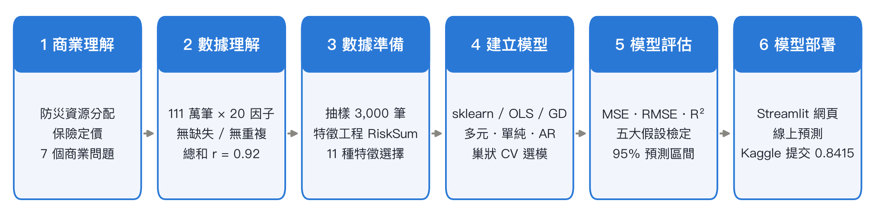

*圖 0　本專案的 CRISP-DM 分析流程與各階段重點*

### 2.1 Business Understanding 商業理解

| | 問題 1：🌊 以 20 個風險因子預測洪水機率 | 問題 2：🧮 以風險總分預測洪水機率 |
|---|---|---|
| 角色 | 政府防災單位的資料分析師 | 保險公司的風險精算師 |
| 商業目標 | 依 20 項環境與社會風險因子估計地區的洪水機率，決定防災資源優先投入哪些面向 | 用簡單易懂的「風險總分」做洪水保險定價 |
| 資料探勘目標 | 多元線性回歸 $y = b + \sum w_i x_i + \epsilon$，找出各因子的影響大小 | 從 24 個候選特徵中以特徵選擇挑出精簡、無共線性的模型 |
| 需回答的問題 | Q1 哪些因子影響最大？ Q2 因子每提高 1 分洪水機率增加多少？ Q3 線性模型能多準確？ | Q1 總分與機率是否線性？ Q2 總分每增 1 分增加多少？何時超過 50%？ Q3 標準差 / 極值是否有額外資訊？ Q4 特徵選擇挑出哪些？是否解決共線性？ |

### 2.2 Data Understanding 數據理解

- **資料量**：train.csv 共 **1,117,957 筆 × 22 欄** (id ＋ 20 個風險因子 ＋ 目標)，test.csv 745,305 筆 (無答案)。
- **資料品質**：缺失值 0、完全重複列 0；20 個因子皆為 0 ~ 19 的整數分數 (平均約 4.9、標準差約 2.1)，分數越高代表該面向洪水風險越高。
- **20 個風險因子**：季風強度 (MonsoonIntensity)、地形排水、河川管理、森林砍伐、都市化、氣候變遷、水壩品質、泥沙淤積、農業活動、侵占河道、防災準備不足、排水系統、海岸脆弱度、山崩、集水區、基礎設施老化、人口密度、濕地流失、規劃不足、政治因素。
- **探索發現**：
  - 20 個因子彼此幾乎不相關 (全部資料中兩兩相關係數絕對值最大僅 0.016)，與目標的相關係數都只有 0.18 ~ 0.19。
  - 但 20 個因子的**總和**與洪水機率的相關係數高達 **r = 0.919** (3,000 筆樣本為 0.914)：單一因子的解釋力很弱，加總後卻非常強，這是本資料最重要的結構。

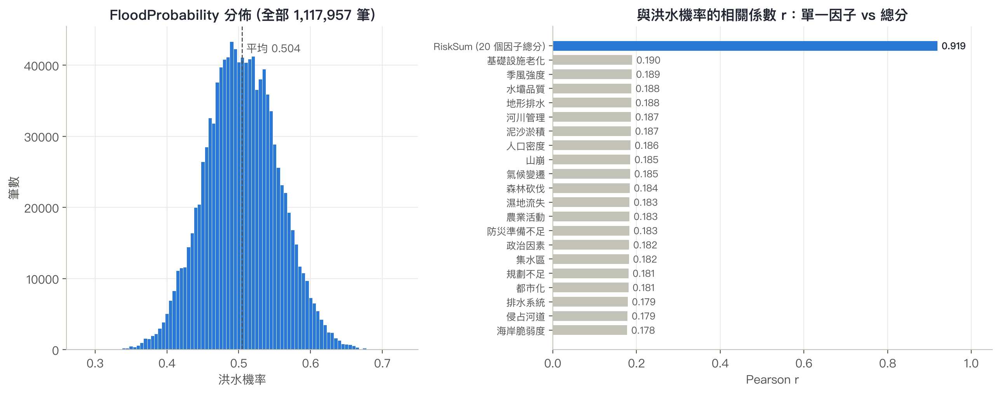

*圖 1　左：洪水機率的分佈 (近似常態、平均 0.504)；右：20 個因子與洪水機率的相關係數都只有約 0.18，總分 RiskSum 則高達 0.919*
- **抽樣說明**：特徵篩選的巢狀交叉驗證 (每個候選方法 × 5 折、SFS、隨機森林、互資訊) 計算量隨筆數放大 (實測 5 萬筆約 3 分鐘)，因此網頁以**簡單隨機抽樣 3,000 筆** (0.27%，random_state = 0) 進行互動分析；網頁中提供「樣本 vs 完整資料」各欄位平均數 / 標準差比較表，最大差異僅約 1.6%，樣本具代表性。

### 2.3 Data Preparation 數據準備

1. 移除識別欄 `id`；檢查缺失值與重複列 (皆為 0)。
2. **特徵工程**：新增 4 個衍生特徵
   - `RiskSum`：20 個因子的總分
   - `RiskStd`：20 個因子的標準差 (分數是否集中)
   - `RiskMax` / `RiskMin`：20 個因子中的最高 / 最低分
3. **候選特徵設計**：
   - 問題 1 只使用 20 個原始因子 → 特徵數 20，**原始特徵即符合 10 ~ 20 個的要求**。
   - 問題 2 把 24 個都當候選 → 超過 20 個，且 `RiskSum` = 20 個因子的線性組合 (**完全共線，VIF = ∞**) → **需要 Feature Selection 才符合條件**。
4. 訓練 / 測試切分 80 / 20：訓練集 2,400 筆、測試集 600 筆；**特徵篩選只使用訓練集**，避免資料洩漏。
5. 梯度下降法啟用特徵縮放 (標準化 X 與 y)，收斂後還原到原始單位。

#### 特徵選擇 (Feature Selection)

網頁依三大類提供 11 種方法，並以「折內篩選的巢狀 5 折交叉驗證」比較所有候選 (篩選在每一折的訓練部分內重做)：

**問題 1 (20 個原始因子)**：

| 方法 | 保留特徵數 | CV RMSE | 測試 R² |
|---|---|---|---|
| 全部特徵 / 相關係數過濾 / RFECV / 向後逐步消除 / LassoCV / ElasticNetCV | 20 | **0.020654** | **0.8371** |
| 隨機森林重要度 (SelectFromModel) | 7 | 0.040432 | 0.2238 |
| SFS / RFE / SelectKBest (k = 5) | 5 | 0.0447 ~ 0.0449 | 0.13 ~ 0.18 |
| 單純線性回歸 (1 個特徵) | 1 | 0.049451 | 0.0266 |

→ 能自動決定特徵數的方法 (RFECV、LassoCV、向後逐步消除) **全部保留 20 個**；「特徵數量 vs R²」曲線從 1 個特徵的 0.009 幾乎線性上升到 20 個的 0.837，沒有平台期。**結論：20 個因子缺一不可，特徵選擇在此的作用是「確認」所有特徵都有貢獻。**

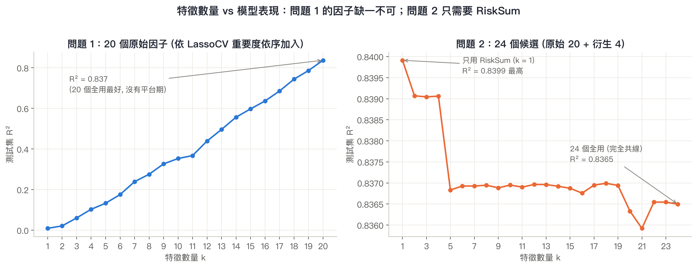

*圖 2　特徵數量 vs 測試集 R²。左 (問題 1)：每加入一個因子 R² 都持續上升，20 個全用最好；右 (問題 2)：只用 RiskSum (k = 1) 的 R² 最高，24 個全用反而較差*

**問題 2 (24 個候選特徵)**：

| 方法 | 保留特徵數 | CV RMSE | 測試 R² |
|---|---|---|---|
| SelectKBest-F (k = 5) — CV 最佳 | 5 | 0.020563 | 0.8368 |
| 前向 / 後向 SFS (k = 5) | 5 | 0.020565 | 0.8371 |
| LassoCV / ElasticNetCV | 5 | 0.020572 | 0.8371 |
| RFECV | 2 | 0.020601 | 0.8377 |
| **⭐ 1-SE 建議：單純線性回歸 / 隨機森林重要度 → `RiskSum`** | **1** | 0.020626 | **0.8399** |
| 全部特徵 (不篩選) | 24 | 0.020655 | 0.8365 |

→ 依 **1-SE 規則** (在 CV RMSE 與最佳者相差不到 1 個標準誤的模型中選特徵最少者) 採用**只用 `RiskSum` 的模型**：

| | 不篩選 (24 個) | 篩選後 (1 個：RiskSum) |
|---|---|---|
| VIF 最大值 | ∞ (完全共線) | **1.00** ✅ |
| 測試 R² | 0.8365 | **0.8399** |
| 測試 RMSE | 0.02050 | **0.02028** |

**結論：特徵選擇把 24 個共線特徵精簡為 1 個，解決了多重共線性，準確度反而更好、模型也更容易解釋。**

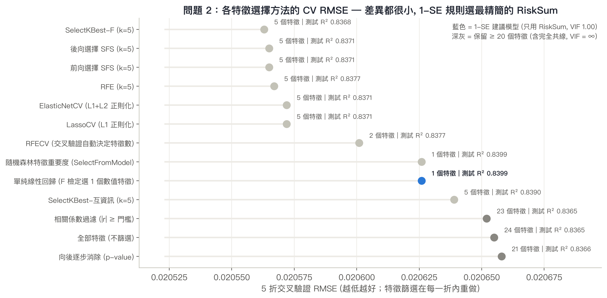

*圖 3　問題 2 各特徵選擇方法的 5 折 CV RMSE (折內篩選)。各方法差距在 0.0001 以內，依 1-SE 規則採用最精簡的 RiskSum 單一特徵*

### 2.4 Modeling 建立模型

- 主要模型為 **sklearn `LinearRegression`**，並以手刻的 **OLS 公式解** $\hat\beta = (X^TX)^{-1}X^Ty$ (數值上以 SVD/lstsq 求解) 與**梯度下降法** (學習率 0.05、2,000 次迭代、特徵縮放) 對照。
- 三種方法的係數與預測完全一致 (問題 1 訓練 R² 皆為 0.8363、測試 R² 皆為 0.8371)，梯度下降的損失曲線收斂良好。
- 係數顯著性 (OLS)：問題 1 的 20 個係數全部顯著 (p < 0.05) 且為正；整體 F 檢定 F = 607.67、p < 0.001。
- 模型比較：多元線性回歸 (測試 R² 0.837) ≫ 單純線性回歸 (以 MonsoonIntensity 為單一特徵，R² 0.027) ≫ AR(p) (資料為橫斷面、列順序隨機，R² ≈ 0，僅作方法示範)。
- 係數圖加上 **OLS 95% 信賴區間誤差線**；單純線性回歸擬合線加上 **95% 信賴帶與 95% 預測區間**。

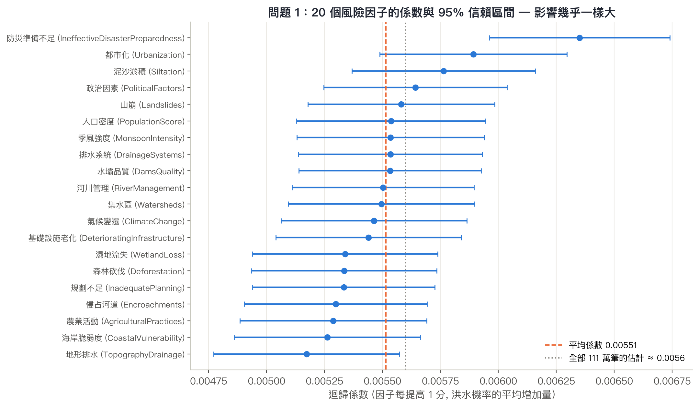

*圖 4　問題 1 的 20 個係數與 95% 信賴區間：所有區間都在 0.005 ~ 0.0065 之間且大幅重疊，各因子的影響幾乎一樣大 (全量資料估計約 0.0056)*

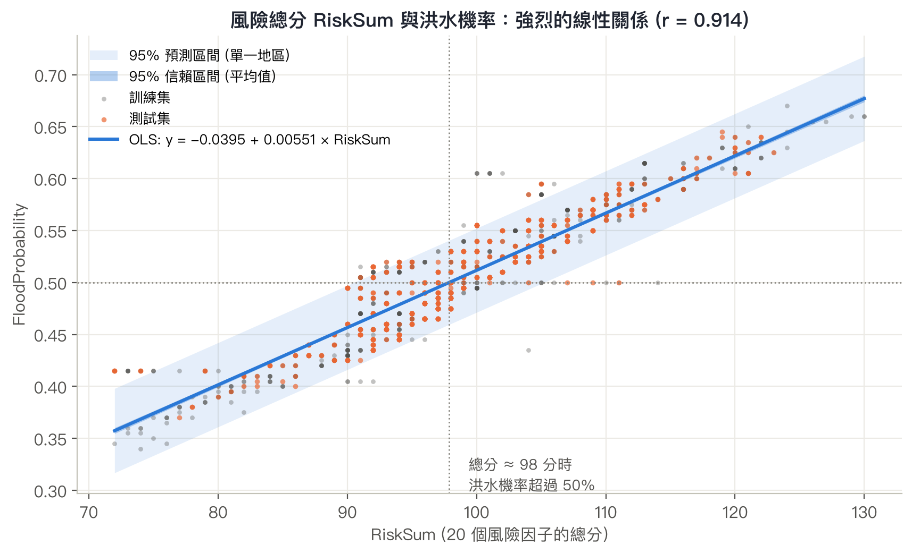

*圖 5　問題 2：RiskSum 與洪水機率的迴歸線 (訓練集配適)，深色帶為 95% 信賴區間、淺色帶為 95% 預測區間；總分約 98 分時預測機率超過 50%*

### 2.5 Evaluation 模型評估

#### 評估指標

| 模型 (問題 / 特徵) | 資料 | R² | Adj R² | MSE | RMSE | MAE |
|---|---|---|---|---|---|---|
| 多元線性回歸 (問題 1, 20 個因子) | 訓練集 | 0.8363 | 0.8349 | 0.000420 | 0.02050 | 0.01600 |
| 多元線性回歸 (問題 1, 20 個因子) | 測試集 | **0.8371** | 0.8315 | **0.000419** | **0.02046** | 0.01647 |
| 線性回歸 (問題 2, RiskSum) | 測試集 | **0.8399** | 0.8396 | 0.000411 | 0.02028 | 0.01635 |
| 單純線性回歸 (MonsoonIntensity) | 測試集 | 0.0266 | 0.0249 | 0.002502 | 0.05002 | 0.04065 |
| AR(3) | 測試集 | −0.0014 | −0.0064 | 0.002691 | 0.05187 | 0.04144 |

- 訓練與測試的 R² 幾乎相同 → 沒有過度擬合。
- 預測值平均只偏離約 1.6 個百分點 (MAE 0.0165)，洪水機率本身的標準差為 0.0507。

#### 預測圖 (95% 信賴區間與預測區間)

網頁第五階段的「📈 預測圖」把測試集依預測值排序，畫出 OLS 預測線、95% 信賴區間 (平均值的不確定性，平均半寬 0.004) 與 95% 預測區間 (單一新樣本的範圍，平均半寬 0.041)，並標出落在區間外的實際值：

| 模型 | 預測區間覆蓋率 (實際值落在 95% 預測區間內的比例) |
|---|---|
| 問題 1 多元線性回歸 | **94.7%** |
| 問題 2 RiskSum | **95.2%** |
| 單純線性回歸 | 95.0% |

覆蓋率都接近 95%，代表區間估計在實務上可靠。AR 模型的遞迴預測圖也加上隨預測步數變寬的 95% 預測區間 (以 MA(∞) ψ 權重計算)。

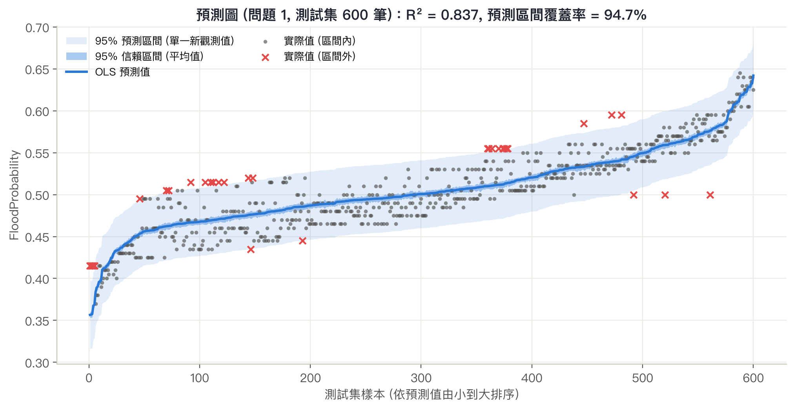

*圖 6　預測圖 (問題 1，測試集 600 筆依預測值排序)：藍線為 OLS 預測值、深色帶為 95% 信賴區間、淺色帶為 95% 預測區間；紅色 × 為落在預測區間外的實際值 (5.3%)*

#### 線性回歸五大假設檢定 (問題 1，訓練集殘差)

| 假設 | 檢定方法 | 統計量 | p-value | 結論 |
|---|---|---|---|---|
| ① 線性 | Ramsey RESET (加入 ŷ²、ŷ³) | F = 36.00 | < 0.001 | ⚠️ 違反 |
| ② 獨立性 | Durbin-Watson | DW = 1.989 | — | ✅ 符合 |
| ③ 常態性 | Jarque-Bera / Shapiro-Wilk | JB = 321.7 (偏態 0.68) | < 0.001 | ⚠️ 違反 |
| ④ 變異數同質性 | Breusch-Pagan | LM = 130.0 | < 0.001 | ⚠️ 違反 |
| ⑤ 無多重共線性 | VIF | max = 1.02 | — | ✅ 符合 |

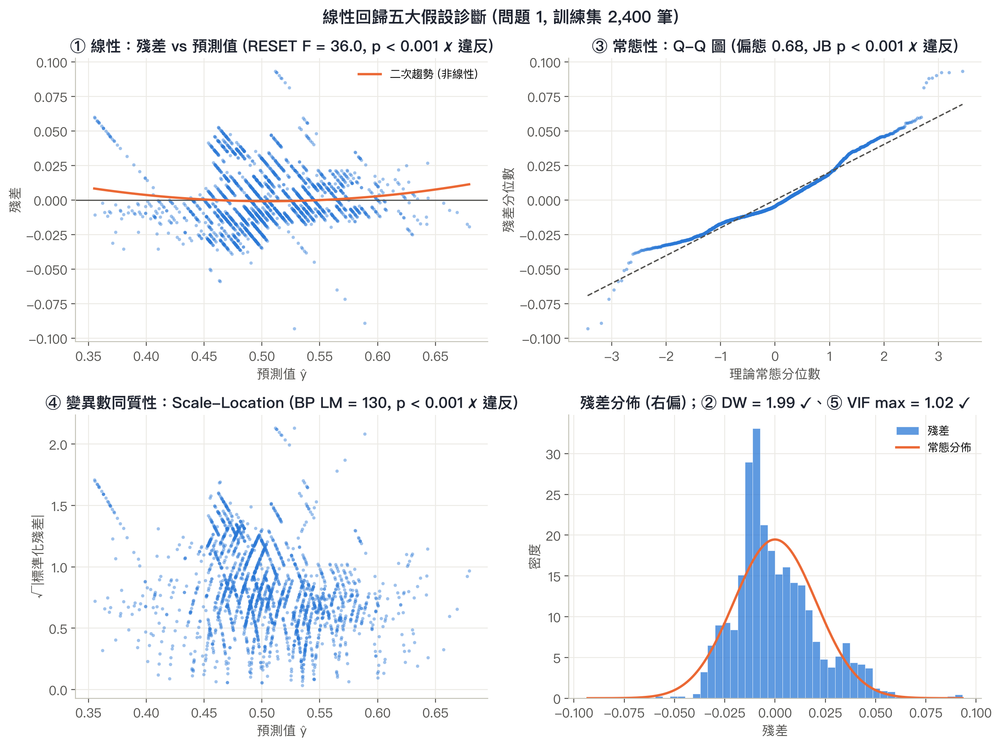

*圖 7　殘差診斷：① 殘差 vs 預測值呈 U 形 (非線性)、③ Q-Q 圖尾端偏離 (右偏)、④ 殘差散佈隨預測值改變 (異質變異)；② 獨立性與 ⑤ 無共線性符合*

**原始特徵 vs 特徵選擇對假設的影響**：

| 條件 | 問題 1 (20 個原始因子) | 問題 2 (24 個候選) |
|---|---|---|
| 特徵數 10 ~ 20 | ✅ 原始特徵即符合 | ❌ 24 個 → ✅ 特徵選擇後 1 個 |
| ② 獨立性 | ✅ 原始特徵即符合 | ✅ |
| ⑤ 無多重共線性 | ✅ 原始特徵即符合 (VIF ≈ 1) | ❌ VIF = ∞ → ✅ **需要特徵選擇才符合** (VIF = 1.00) |
| ①③④ 線性 / 常態 / 同質變異 | ⚠️ 違反 | ⚠️ 違反 (特徵選擇無法改善) |

- 實測對 y 做 log、logit、√、Box-Cox 轉換或加入 `RiskSum²`，①③④ 仍無法通過：殘差的右偏是這份 Kaggle 合成資料的結構性特徵。
- **影響**：OLS 係數仍為不偏估計，預測值與 MSE / RMSE / R² 依然有效；受影響的是標準誤、p-value 與區間估計的準確度。2,400 筆訓練資料讓檢定力很高，輕微偏離也會被判為顯著；Q-Q 圖顯示偏離屬中等程度，加上預測區間覆蓋率約 95%，區間估計在實務上仍可用。可用穩健標準誤 (HC3) 補強推論。
- **① 線性違反正是線性模型的天花板所在**：第 6 節的 Kaggle 頂尖解法 (GBDT) 能多拿到約 0.028 的 R²，就是因為抓到了這部分非線性訊號。

#### 商業問題解答

**問題 1 (防災單位)**

- **Q1 哪些因子影響最大？** 20 個因子全部顯著且為正向。係數最大的是防災準備不足 (0.00615)、都市化 (0.00591)、泥沙淤積 (0.00575)，但最大與最小只差平均值的 16%；以全部 111 萬筆資料估計時 20 個係數都約 0.0056。**影響幾乎一樣大 → 防災資源應全面降低各項風險，而非集中單一面向。**
- **Q2 因子每提高 1 分？** 任一因子提高 1 分，洪水機率平均增加約 **0.00554** (0.55 個百分點，95% CI [0.00546, 0.00562])；20 個因子同時提高 1 分約增加 11.1 個百分點。
- **Q3 多準確？** 測試 R² = **0.837**，平均誤差約 1.6 個百分點；剩下約 15% 無法用線性加總解釋。

**問題 2 (保險精算)**

- **Q1** `RiskSum` 與洪水機率 r = 0.914，單靠總分即可解釋 **83.5%** 的變異。
- **Q2** 總分每增加 1 分，洪水機率增加 **0.00553** (95% CI [0.00544, 0.00562])；迴歸式 `FloodProbability ≈ −0.0417 + 0.00553 × RiskSum`，**總分約 98 分時洪水機率超過 50%** (資料中總分的中位數也是 98 分)。
- **Q3** 控制總分後，RiskStd / RiskMax / RiskMin 皆不顯著，R² 只從 0.8353 增加到 0.8357 → **用風險總分單一指標定價就已足夠。**
- **Q4** 特徵選擇從 24 個候選中只保留 `RiskSum`，VIF 從 ∞ 降到 1.00，測試 R² 從 0.8365 提升到 0.8399。

### 2.6 Deployment 模型部署

- **線上預測**：在網頁輸入各特徵值 (僅需輸入篩選後仍使用的特徵)，即時得到 sklearn / OLS 與梯度下降的預測值；AR 模型提供多步遞迴預測與 95% 預測區間。
- **匯出**：下載資料 CSV 與模型參數 JSON (截距、各特徵權重、梯度下降設定)。
- **Kaggle 提交**：「🏁 產生 Kaggle 提交檔」以目前模型預測 test.csv 的 745,305 筆，輸出與 sample_submission.csv 相同格式的 `submission.csv`。本專案提交結果：**Private 0.84150 / Public 0.84209** (截圖見附錄 B)。
- **上線方式**：本機 `streamlit run main.py`；或上傳 GitHub 後部署到 Streamlit Community Cloud；或以 `index.html` (stlite) 做純前端靜態網頁 (可放在 GitHub Pages)。

---

## 3. AI 協助說明

### 3.1 作業「AI 協助要求」對照

| 作業要求 | 對應位置 | 狀態 |
|---|---|---|
| 所有與 ChatGPT / AI 的對話以 pdfCrowd 或其他方式匯出為 PDF | 第 3.3 節；匯出檔 `附錄A_AI對話紀錄.pdf` (39 頁，由 Claude Code 的對話匯出功能＋macOS WebKit 轉成 PDF) | ✅ |
| 使用 NotebookLM 研究網路上同主題的解法，撰寫 100 字以上摘要 | 第 5.2 節「📓 NotebookLM 摘要」、第 5.3 節詳細拆解 | ✅ |
| 報告中明確標示「GPT 輔助內容」 | 第 4 節，以及第 6 節標頭 (🤖 標籤＋開始 / 結束標記) | ✅ |
| 報告中明確標示「NotebookLM 摘要」 | 第 5 節 (📓 標籤＋開始 / 結束標記) | ✅ |

### 3.2 內容標示說明

本報告以下列標籤區分內容來源：

| 標籤 | 意義 | 出現位置 |
|---|---|---|
| 🤖 **GPT 輔助內容** | 由 AI 助理協助產生或整理的內容 (本專案程式與報告是與 AI 程式助理 Claude Code 協作完成) | 第 4 節、第 6 節 |
| 📓 **NotebookLM 摘要** | 由 NotebookLM 根據匯入的資料來源產生的研究摘要 | 第 5 節 |
| 👤 **本人分析與結果** | 資料集選擇、需求與決策、Kaggle 提交與成績；第 2 節的所有數據都是程式實際執行的結果 | 第 1、2、7 節 |

> 說明：第 1、2、7 節的文字敘述也由 AI 協助撰寫初稿，所有數據均由本專案程式實際執行產生，並經本人確認。

### 3.3 對話紀錄匯出為 PDF (pdfCrowd)

1. **ChatGPT 對話**：在對話頁面右上角按「分享」→ 建立分享連結 → 到 [pdfCrowd 的網頁轉 PDF 工具](https://pdfcrowd.com/) 貼上連結 → 轉換並下載 PDF。
2. **Claude Code / 其他 AI 對話**：在對話頁面使用瀏覽器「列印 → 另存為 PDF」，或把對話匯出 / 分享連結後同樣用 pdfCrowd 轉成 PDF。
3. 將匯出的 PDF 依序命名 (例如 `附錄A-1_AI對話紀錄.pdf`)，附在報告 PDF 最後。

---

## 4. 🤖 GPT 輔助內容

> **【🤖 GPT 輔助內容 — 開始】** 本節記錄與 AI 助理的協作過程；完整對話紀錄見附錄 A (`附錄A_AI對話紀錄.pdf`)。

### 4.1 對話過程摘要

| # | 我的需求 (Prompt) | AI 協助完成的內容 |
|---|---|---|
| 1 | 把原本 50 Startups / Boston Housing 的程式改用 Kaggle 資料分析，功能不要變 (第一版使用 Istanbul 公寓房價資料) | 改寫資料載入、清理與商業情境，保留所有功能 |
| 2 | 網頁載入的套件太久 | 移除 statsmodels (散佈圖趨勢線改用 numpy 計算) |
| 3 | RMSE 圖預設顯示最低點星號；特徵篩選設定移到 Feature Selection 區；改成一頁式網頁 | 調整圖表、把控制面板移入第三階段、移除分頁改為一頁式並加入快速跳轉 |
| 4 | 預設使用 Embedded → LassoCV | 修改預設篩選方法 |
| 5 | 好像沒有回答一開始設定的商業問題 | 新增「🎯 回答商業問題」區塊，依模型結果自動產生解答 |
| 6 | 把 UI 做漂亮 | 設計 Hero 標題、KPI 卡片、階段標題卡、統一的色盲友善圖表配色 |
| 7 | 出現 f-string SyntaxError | 發現本機為 Python 3.9，修正為相容寫法 |
| 8 | 畫面加寬；圖表需要信賴區間嗎？ | 係數圖加 95% CI 誤差線、單純線性回歸加信賴帶與預測區間 |
| 9 | 自回歸的日期應該很重要 (Istanbul 資料時期) | 說明橫斷面資料與時間序列的差異，改以刊登日期彙總每日中位數建構時間序列 (換成洪水資料後因無時間欄位而移除) |
| 10 | 換成 Kaggle Playground S4E5 洪水資料 | 改寫兩個問題、特徵工程、資料字典、Kaggle submission 產生功能 |
| 11 | 檢查是否符合作業要求 (Feature Selection、MSE、RMSE、R²、五大假設、預測圖) | 補上 MSE、五大假設檢定、預測圖 (信賴區間 / 預測區間)；確認原始特徵與需特徵選擇的條件 |
| 12 | 特徵選擇有意義嗎？ | 分析發現 20 個因子缺一不可；問題 2 改為 24 個候選，用特徵選擇解決共線性並挑出 RiskSum |
| 13 | train.csv 很多筆，為什麼只用 2,000 筆？ | 說明計算量考量，預設改為 3,000 筆並在畫面上加入抽樣說明與代表性檢查 |
| 14 | 依目前內容生成報告 | 產生本 README 報告，並整理 Kaggle 前四名解法 |
| 15 | 加入作業的「AI 協助要求」(對話匯出 PDF、NotebookLM 摘要、明確標示) | 新增 AI 協助說明、要求對照表、內容標示 (🤖 / 📓)、pdfCrowd 匯出步驟、NotebookLM 研究步驟與提示詞 |
| 16 | 報告要放圖輔助說明 | 依網頁相同設定重新計算，繪製 9 張分析圖 (CRISP-DM 流程、特徵選擇、係數信賴區間、預測區間、假設診斷、Kaggle 比較) 並插入報告 |

### 4.2 AI 協助產生的內容清單

- **程式**：`main.py` 的資料清理、特徵工程、特徵選擇 (11 種方法＋巢狀交叉驗證)、OLS / 梯度下降、五大假設檢定、信賴區間 / 預測區間、商業問題自動解答、UI 設計、Kaggle submission 產生功能；`index.html` 瀏覽器版。
- **報告**：本 README 的架構與文字初稿、圖 0 ~ 圖 8、第 6 節 Kaggle 前四名解法的研究摘要、整理與比較。
- **本人負責**：選擇資料集與作業方向、提出每一步需求與修改意見、檢查結果、提交 Kaggle (Private 0.84150 / Public 0.84209)。

### 4.3 過程中的關鍵學習

- AI 會主動驗證：每次修改都在本機 Python 3.9 環境跑完 2 個問題 × 3 種模型的自動化測試，並開瀏覽器檢查畫面。
- AI 也會指出資料本身的限制，例如五大假設中有 3 項違反、且無法以轉換或特徵選擇修正，並如實寫進報告，而不是硬湊出「全部通過」的結果。
- 開發中也修正了數值問題：特徵數值很大時 (例如房價 1e7) 直接計算 $X^TX$ 會失去精度、截距被誤判為 0，改以 SVD (lstsq) 求解。

> **【🤖 GPT 輔助內容 — 結束】**

---

## 5. 📓 NotebookLM 摘要

> **【📓 NotebookLM 摘要 — 開始】**

### 5.1 研究方式

1. 到 [NotebookLM](https://notebooklm.google.com/) 建立新的筆記本。
2. 用「新增來源 → 網站」匯入下列資料來源 (Kaggle 頁面若無法直接匯入，可先把頁面內容複製成文字來源)：
   - Kaggle 競賽資料頁：<https://www.kaggle.com/competitions/playground-series-s4e5/data>
   - 第 1 名解法：<https://www.kaggle.com/competitions/playground-series-s4e5/writeups/aldparis-1st-place-solution>
   - 第 2 名解法：<https://www.kaggle.com/competitions/playground-series-s4e5/writeups/peaky-blenders-2nd-place-solution-team-peaky-blend>
   - 第 3 名解法：<https://www.kaggle.com/competitions/playground-series-s4e5/writeups/tilii-3-solution-a-blend-of-57-models>
   - 第 4 名解法：<https://www.kaggle.com/competitions/playground-series-s4e5/writeups/4th-place-solution-hill-climbing-through-the-noise>
3. 在對話框輸入下方提示詞，回覆收錄於 5.2 節；再請 NotebookLM 逐一拆解前四名解法，收錄於 5.3 節。

**建議提示詞**：

```text
請根據這些來源，用繁體中文撰寫一份 200 字左右的研究摘要，說明：
1. 這份洪水預測資料的結構，以及為什麼 20 個特徵的總和是最重要的訊號；
2. 前幾名解法在特徵工程、模型與集成方法上的共同做法；
3. 線性回歸 (R² 約 0.844) 與頂尖解法 (R² 約 0.869) 的差距主要來自哪裡。
```

### 5.2 NotebookLM 產生的摘要 (100 字以上)

本研究摘要歸納 Kaggle 洪水預測競賽前四名解法：

1. **資料結構與總和訊號**：資料集特徵呈現**泊松分佈（Poisson distribution）**，20 個原始特徵的列總和（sum）構成了與洪水機率高度相關的最強主訊號。
2. **頂尖解法之共同做法**：
   - **特徵工程**：著重提取橫向統計量（sum, std, max）、排序特徵（sorted features）與數值出現次數的計數特徵（count features），並主動剔除冗餘原始特徵。
   - **模型建構**：大量訓練多元梯度提升樹（GBM：CatBoost, XGBoost, LightGBM）並高度整合 AutoGluon AutoML 模型。
   - **集成融合**：結合數十個（甚至 50+ 個）異質模型預測，利用 Ridge、Lasso 或 Hill Climbing 演算法計算最佳權重進行加權融合。
3. **線性回歸與頂尖解法之差距**：單純線性回歸僅能捕捉總和的線性主訊號；頂尖解法（R² 約 0.869）的提升主要來自於利用 GBM 擬合偏離總和的非線性雜訊、構造高級統計與 Target Encoding 特徵，以及透過大規模模型大融合（Blending）相互抵消預測雜訊。

### 5.3 NotebookLM 前四名解法詳細拆解

本研究摘要針對 Kaggle 洪水預測大賽（Playground Series s4e5）前四名解法進行系統性梳理與技術比對。

#### 一、資料特性與問題核心

- **泊松分佈特性**：資料集中特徵與數值呈現泊松分佈（Poisson distribution）特徵。
- **強訊號與雜訊分離**：原始特徵的橫向總和（Sum）與目標變數 `FloodProbability` 高度相關，但細部變異帶有大量雜訊。
- **多模型融合必備性**：由於題目本質上是在從雜訊中提取微小訊號，單一模型容易瓶頸，因此**跨模型融合（Ensembling / Blending）**成為決定最終勝負的關鍵。

#### 二、前四名解法技術拆解

**🥇 第一名解法（aldparis / adaubas）**

- **特徵工程（Feature Engineering）**：
  - 特徵提取：計算每列的總和（sum）、標準差（std）、最大值（max）、排序後的原始特徵（sorted features），以及特定數值門檻（如大於 6、7、8）的計數特徵（Count features）。
  - 篩選與剔除：利用置換特徵重要性（Permutation Feature Importance）與後向選擇法（Backward technique），主動剔除原始特徵、偏度（skewness）與峰度（kurtosis）等無效特徵。
  - 魔法特徵與目標轉換：使用 `train.groupby("sum")["FloodProbability"].std()` 作為 Target Encoder，並對目標變數進行扣除平均值的轉換，以分離強訊號與雜訊。
- **模型多樣性與調優**：訓練超過 30 個涵蓋不同特徵組合的 GBM 模型（CatBoost, XGBoost, LightGBM）。前 10 天僅使用預設參數集中精力於特徵工程，後期才使用 Optuna 針對樹深度、葉子數及正則化參數進行自動化調優。
- **融合策略**：
  - 使用 Ridge 回歸（設定 `positive = False`, `fit_intercept = False`）搭配 3 次重複 K 折交叉驗證（3 repeated k-fold OOF）。
  - 結合自身 GBM、AutoGluon 生成的多組 OOF 預測檔案以及公開社群的最佳預測結果。

**🥈 第二名解法（Team Peaky Blenders: lash_fire & mdoroch）**

- **模型組合**：組合了 56 個模型（排除 AutoGluon 部分），包含 XGBoost、CatBoost、LightGBM，並嘗試了 Natural Gradient Boosting (NGB)、Linear Tree Regression 等新型模型。
- **融合機制**：
  - 先使用 `LinearRegression()` 針對不同特徵/模型子集建立中間融合特徵。
  - 透過**前向特徵選擇（Forward Feature Selection）**自動選出最佳特徵組合。
  - 最終採用加權混合：`0.6 * 線性回歸融合模型 + 0.4 * 隊友包含了 AutoGluon 及 PyBoost 的最佳解`。

**🥉 第三名解法（Tilii / tilii7）**

- **模型規模與 Lasso 融合**：
  - 採用 Lasso 回歸融合高達 57 個模型（包含 AutoGluon 模型、LightGBM、CatBoost 與神經網路）。
  - 在 Lasso 權重分配中，約有 40% 的模型被給予負係數。
- **關鍵洞察**：發現融合前 5 個核心模型後，進一步增加模型數量對分數提升非常微小（僅在小數點後第 5 或第 6 位變動），但這種微幅提升在頂尖爭奪中是衝上第三名的關鍵。

**🏅 第四名解法（Matt OP / mattop）**

- **統計特徵與出現次數計數**：使用 3 組特徵集（FE2, FE3），包含均值、中位數、標準差、極值、偏度、峰度、分位數等統計量，以及每列唯一值出現次數的計數特徵。
- **Hill Climbing 算法**：開發並使用其 open-source Python 套件 `hillclimbers` 進行**爬山算法（Hill Climbing）**優化模型權重，效果優於 Lasso/Ridge。

#### 三、競賽共通勝選公式

1. **特徵工程優於早期調參**：頂尖參賽者皆先著重於數據探索（EDA）與特徵構建（如排序特徵、行統計量、計數特徵），最後階段才進行超參數調優。
2. **AutoML（AutoGluon）的關鍵角色**：前三名皆高度整合 AutoGluon 所輸出的 OOF 預測，作為強大的基礎模型源。
3. **異質模型大量融合（Ensemble/Blending）**：不論使用 Ridge、Lasso、Linear Regression 還是 Hill Climbing，結合大量不同算法（GBM, AutoML, Linear Trees, NN）能有效抵禦資料雜訊並確保 CV 與榜單成績的一致性。

### 5.4 對照說明與核對註記

> 第 6.1 節有一份由 AI 助理閱讀前四名 writeup 後整理的研究摘要 (標示為 🤖 GPT 輔助內容)，可用來核對 NotebookLM 的摘要是否涵蓋三個重點：資料結構 (總和是最強訊號)、前幾名的共同做法 (特徵工程、GBDT / AutoGluon、集成)、以及線性回歸與頂尖解法的差距來源。本節以 NotebookLM 的產出為準。

**與 Kaggle writeup 原文的核對結果** — 🤖 **GPT 輔助內容** (非 NotebookLM 輸出；由 AI 助理逐項比對前四名 writeup 原文)：

| NotebookLM 的敘述 | 原文核對 | 結果 |
|---|---|---|
| 第 1 名：sum / std / max、排序特徵、大於 6、7、8 的計數特徵；剔除原始特徵、偏度、峰度；以 `groupby("sum")` 做目標編碼；Ridge (positive = False、fit_intercept = False) ＋ 3 次重複 K 折 OOF | 與原文一致 (目標轉換原文為 `FloodProbability − 0.1 × 原始特徵平均`) | ✅ |
| 第 2 名：56 個模型 (不含 AutoGluon)、NGB / Linear Tree、LinearRegression 子集融合＋前向特徵選擇、最終 0.6 / 0.4 加權 | 與原文一致 | ✅ |
| 第 3 名：Lasso 融合 57 個模型、約 40% 負係數、約 5 個模型後提升只在小數點第 5 ~ 6 位 | 與原文及作者留言一致 | ✅ |
| 第 4 名：統計特徵＋每列數值出現次數、`hillclimbers` 套件，效果優於 Lasso / Ridge | 作者表示在**他自己的模型**上 hill climbing 最好；第 3 名留言指出同一組模型 hill climbing 0.86901 與 Lasso 0.86902 幾乎相同 | ⚠️ 差異極小 |
| 「前三名皆高度整合 AutoGluon 所輸出的 OOF 預測」 | 第 2 名原文說明**沒能取得 AutoGluon 的 OOF 預測** (時間不足與版本問題)，而是與隊友已含 AutoGluon 的最佳解做 0.6 / 0.4 加權 | ⚠️ 不完全正確 |

> **【📓 NotebookLM 摘要 — 結束】**

---

## 6. 網路上主流 / 更優解法之比較與說明

> 🤖 **GPT 輔助內容**：本節 (含研究摘要) 由 AI 助理閱讀 Kaggle 前四名 writeup 後整理；本專案的數據與 Kaggle 成績為本人實際執行與提交的結果。

### 6.1 研究摘要

Kaggle Playground S4E5 的洪水預測資料由 20 個整數風險因子組成，第 1 名指出這些欄位近似 Poisson 分佈，而 20 個因子的總和與洪水機率高度線性相關，因此「總和」是最強的單一訊號，線性回歸即可達到約 0.844 的 R²。前幾名解法的共同做法是：以總和、標準差、最大最小值、排序後的因子、各數值出現次數與以總和分組的目標編碼等特徵，捕捉總和以外的細微非線性；以 LightGBM、XGBoost、CatBoost 與 AutoGluon 為主力模型；再用 Ridge、Lasso、LinearRegression 或 hill climbing 集成數十個模型，最終 Private R² 約 0.869。第 3 名也指出，集成約 5 個模型後的提升僅在小數點第五、六位 (集成只比最佳單一模型多 0.00012)；由此可見，真正拉開與線性模型差距 (約 0.025) 的是 GBDT 對非線性的學習能力，而非集成本身。

### 6.2 Kaggle 前四名解法整理

| 名次 | 作者 | 模型 | 關鍵特徵工程 | 集成方式 | 公布成績 (R²) |
|---|---|---|---|---|---|
| 🥇 1st | aldparis | 30+ 個 GBM (CatBoost、XGBoost、LightGBM) ＋ AutoGluon | 每列的總和、標準差、最大值；**排序後的原始特徵**；計數特徵 (大於 6/7/8 的因子個數)；以總和分組的目標編碼 (`groupby("sum")` 的 FloodProbability 標準差)；目標轉換 (y − 0.1 × 特徵平均)。用 permutation importance 與後向法刪掉原始特徵、偏態、峰態等無用特徵 | Ridge 回歸集成 (positive = False、fit_intercept = False)，以 3 次重複 K 折 OOF 預測訓練 | Public 0.86943 |
| 🥈 2nd | Team Peaky Blenders (lash_fire、mdoroch) | 56 個模型 (XGB、CatBoost、LGBM、NGBoost、Linear Tree 等) ＋ AutoGluon | 採用社群公開的特徵 (統計特徵、排序特徵等) | LinearRegression 集成「多組子集合的集成」(blends of blends)，再做前向特徵選擇；最終 0.6 × 自家集成 ＋ 0.4 × 隊友集成 | Public 0.86943 / **Private 0.86902** |
| 🥉 3rd | Tilii | 57 個模型 (含 AutoGluon 集成)；最佳單一模型為 LightGBM / CatBoost | — | **Lasso** 集成 (約 40% 模型權重為負) | **Private 0.86902** (最佳單一模型 0.86890、AutoGluon 0.86893) |
| 4th | Matt OP | 多種模型 (含多組超參數的決策樹等) | 統計特徵 (平均、中位數、眾數、最大、最小、標準差、偏態、峰態、分位數)；每列各數值的出現次數 | **Hill climbing** 搜尋集成權重 (作者自製套件 hillclimbers) | — (writeup 未列出) |

**共同點**：

1. **特徵工程是關鍵**：大家都發現「20 個因子的總和」是最強訊號 (第 1 名指出資料是多個 Poisson 分佈的總和)，再加上排序特徵、計數特徵與分組目標編碼，捕捉「總和以外」的細微非線性。
2. **梯度提升樹 (GBDT) ＋ AutoML (AutoGluon)** 是主力模型；神經網路幫助有限 (第 3 名的觀察)。
3. **大量模型集成**：用 Ridge / Lasso / LinearRegression / Hill climbing 決定權重；但約 5 個模型後的改進只在小數點第 5 ~ 6 位 (第 3 名：集成比最佳單一模型只多 0.00012)。
4. **相信交叉驗證**：CV 與 Public / Private LB 高度一致，第 1 名在最後兩週只提交 2 次。

### 6.3 本專案與主流解法的比較

| 方法 | R² | 說明 |
|---|---|---|
| 單純線性回歸 (1 個因子) | ≈ 0.03 | 單一因子解釋力很弱 |
| **本專案：線性回歸 (3,000 筆樣本)** | 測試 0.837 ~ 0.840 | 可解釋、可做假設檢定與區間估計 |
| **本專案 Kaggle 提交** | **Private 0.84150 / Public 0.84209** | 預測 745,305 筆 test.csv |
| 線性回歸 (全部 111 萬筆, 80/20 切分) | 0.844 | 線性模型的天花板 |
| 最佳單一 GBDT (第 3 名) | Private 0.86890 | 捕捉非線性 |
| 前幾名的集成 | Private ≈ 0.869 | 數十個模型的集成 |

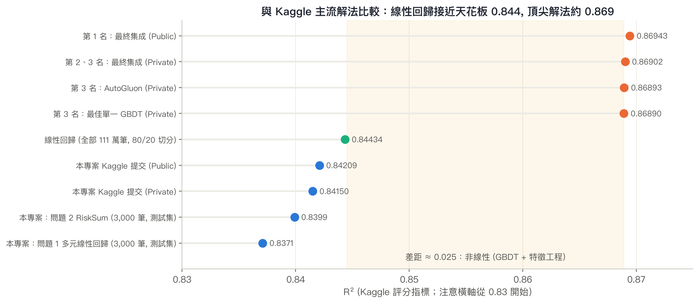

*圖 8　本專案與 Kaggle 前幾名的 R² 比較 (橫軸從 0.83 開始以放大差異)：線性回歸的天花板約 0.844，頂尖解法約 0.869*

**差距在哪裡？**

1. **非線性 (約 +0.025)**：本專案的 RESET 檢定顯示存在線性模型沒抓到的非線性關係。GBDT 搭配排序特徵、計數特徵、以總和分組的目標編碼，能學到「同樣總分下，因子分佈不同時機率的差異」，這是 R² 從 0.844 提升到 0.869 的主要來源。
2. **資料量 (約 +0.003)**：本專案為了互動速度只用 3,000 筆訓練；以全部資料訓練的線性回歸可提升到約 0.844。
3. **集成 (約 +0.0001)**：大量模型集成在競賽中決定名次，但對實務幫助極小 (第 3 名也承認實務上不值得)。

**線性回歸仍有的價值**：

- **可解釋性**：每個係數直接回答商業問題 (每提高 1 分增加多少機率、總分 98 分超過 50%)，GBDT 很難提供這種直覺。
- **統計推論**：信賴區間、預測區間 (覆蓋率約 95%) 與假設檢定，是集成模型難以提供的。
- **效率**：只用 1 個特徵 (RiskSum) 就達到 0.84，約是最佳成績的 97%。

**若要在本專案框架內進一步改善**：

- 使用全部訓練資料 (網頁側邊欄「內建資料取樣筆數」設為 0)。
- 加入第 1 名提到的特徵 (排序後的因子、計數特徵、以 RiskSum 分組的目標編碼)，或對 RiskSum 使用樣條 (spline) / 分段線性，以捕捉非線性。
- 改用穩健標準誤 (HC3) 處理異質變異，使推論更可靠。
- 若目標是競賽分數：改用 LightGBM / CatBoost / AutoGluon，再以 Ridge 或 hill climbing 集成。

---

## 7. 結論與限制

**結論**

1. 本資料集具 20 個特徵，**原始特徵即符合** 10 ~ 20 個特徵、獨立性、無多重共線性等條件；加入衍生特徵後 (24 個) 產生完全共線，**需要特徵選擇才符合**，特徵選擇把特徵精簡為 `RiskSum` 1 個並提升測試 R² (0.8365 → 0.8399)。
2. 多元線性回歸測試 R² 約 0.837、RMSE 約 0.0205、MSE 約 0.00042，Kaggle Private 成績 0.84150，接近線性模型的天花板 (全部資料約 0.844)。
3. 20 個風險因子的影響幾乎相同 (每 1 分約 +0.0055)，洪水機率主要由「風險總分」決定：防災應全面改善，保險定價可用單一總分。
4. 與 Kaggle 頂尖解法 (≈ 0.869) 的差距主要來自非線性，這與五大假設檢定中「線性假設違反」的結果一致。

**限制**

- 這是 Kaggle 以深度模型從原始洪水資料**合成**的資料，因子之間幾乎獨立、殘差呈結構性右偏，與真實世界的洪水資料不同；線性、常態、同質變異三項假設無法透過轉換或特徵選擇滿足。
- 為了互動速度，網頁預設只用 3,000 筆樣本，係數估計會有抽樣誤差 (例如各因子係數的排名在信賴區間內可能互換)。
- 資料沒有時間欄位，自迴歸 (AR) 僅作方法示範。

---

## 8. 附錄

- **附錄 A**：AI 對話紀錄 (`附錄A_AI對話紀錄.pdf`)
- **附錄 B**：Kaggle 提交成績截圖
- **附錄 C**：網頁操作畫面截圖

### 附錄 B　Kaggle 提交成績

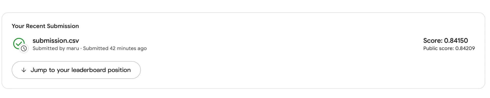

*本專案以網頁「🏁 產生 Kaggle 提交檔」功能產生的 `submission.csv` 提交 Kaggle Playground Series S4E5：**Private 0.84150 / Public 0.84209** (評分指標為 R²)*

### 附錄 C　網頁操作畫面截圖

以下為網頁預設設定 (問題 1、多元線性回歸、抽樣 3,000 筆、Seed 0) 下的畫面，依 CRISP-DM 階段排列。

**C-1　頁首：資料集資訊、快速跳轉按鈕與 KPI 卡片 (測試集 R² 0.837、MSE、RMSE、MAE)** (對應第 1、2.5 節)

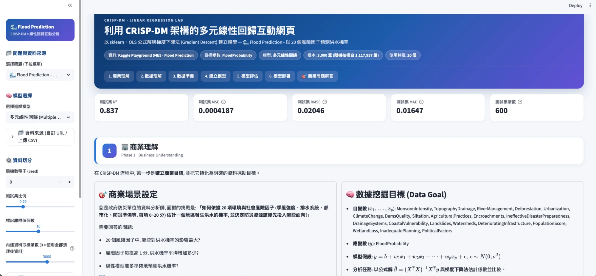

**C-2　第一階段 商業理解：商業場景、需要回答的問題、數據挖掘目標與資料集來源 / 特徵數說明** (對應第 2.1 節)

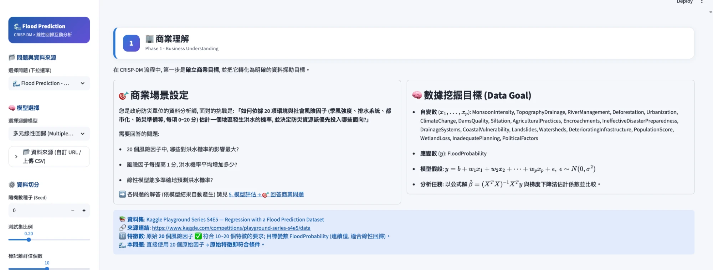

**C-3　第二階段 數據理解：資料來源、📌 抽樣說明 (3,000 / 1,117,957 筆) 與前 10 筆資料** (對應第 2.2 節)

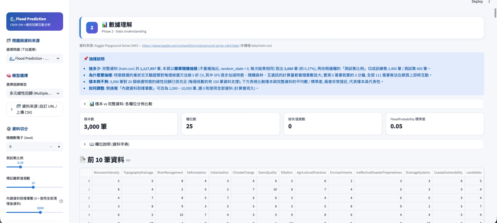

**C-4　第三階段 數據準備：前處理摘要 (清理、特徵工程、抽樣、切分) 與編碼後的 X** (對應第 2.3 節)

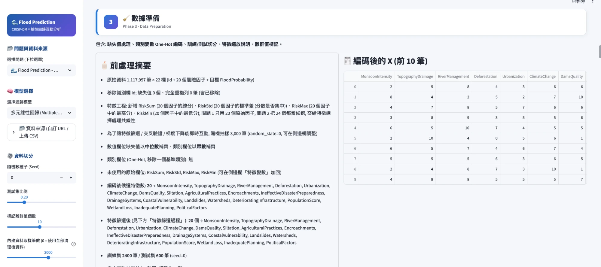

**C-5　第三階段 特徵篩選：Filter / Wrapper / Embedded 演算法選擇、參數與最佳模型搜尋設定** (對應第 2.3 節)

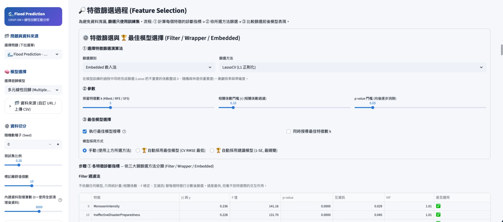

**C-6　第四階段 建立模型：sklearn / OLS 公式解 / 梯度下降的係數比較與 95% 信賴區間係數圖** (對應第 2.4 節)

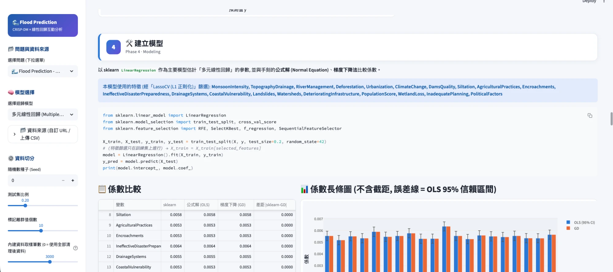

**C-7　第四階段 最佳模型選擇：各特徵選擇方法的 5 折 CV RMSE 排行榜** (對應第 2.3、2.4 節)

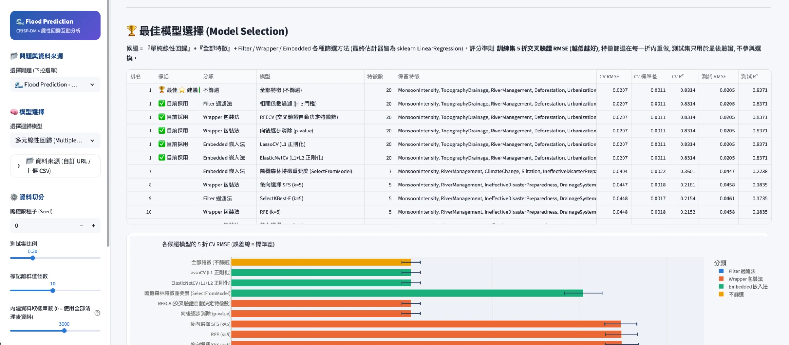

**C-8　第五階段 模型評估：R² / Adj R² / MSE / RMSE / MAE、5 折交叉驗證與預測圖 (95% 信賴區間 / 預測區間)** (對應第 2.5 節)

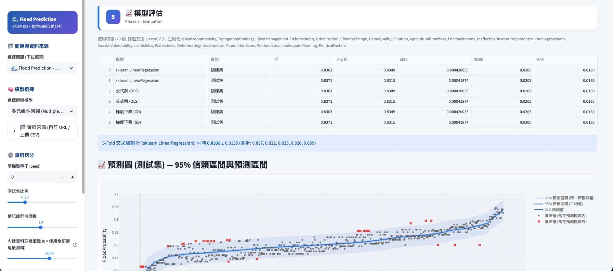

**C-9　第五階段 特徵數量 vs 模型表現：RMSE / R² 曲線與各 k 的結果表** (對應第 2.3 節)

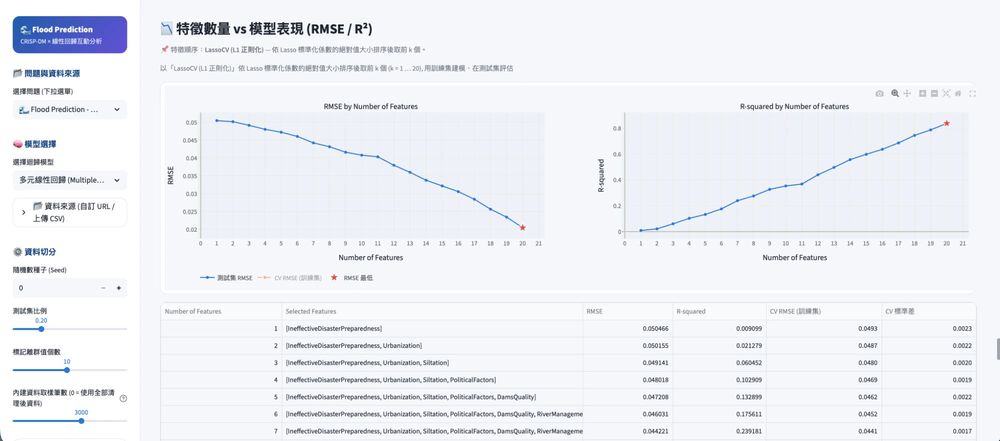

**C-10　第五階段 圖表解讀與結論：依 1-SE 規則建議使用 20 個特徵** (對應第 2.3 節)

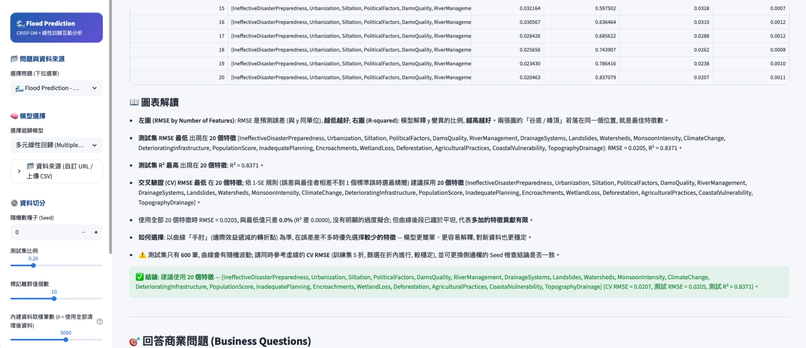

**C-11　🎯 回答商業問題：問題 1 的 Q1 ~ Q3 自動解答** (對應第 2.5 節)

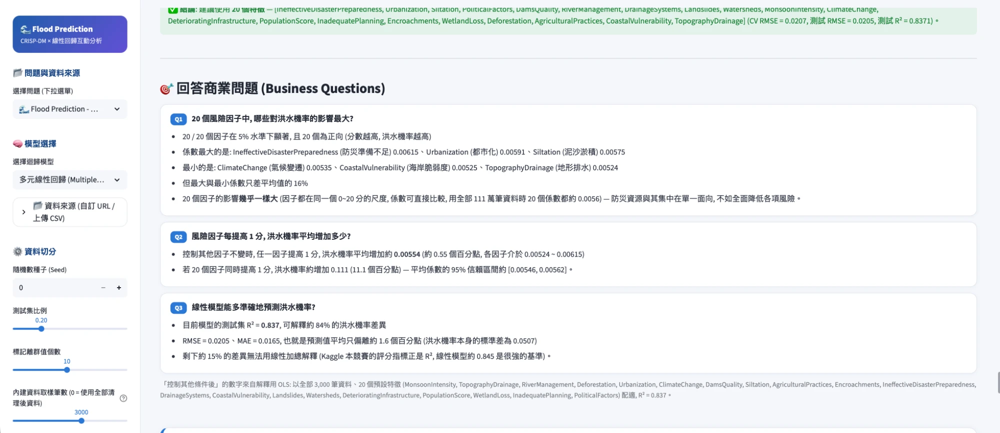
